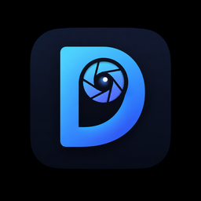

<div align="center">



# Dorawa (도라와)

**리눅스 · 윈도우 노트북 도난 추적기**

노트북이 도난당하면 위치 · 주변 와이파이 · 원격 촬영(사진/영상)을
자체 서버로 보고하고, 주인은 데스크톱 앱 · 스마트폰 앱 · 웹에서 추적합니다.


</div>

---

## 무엇인가요

Dorawa는 제3자 메신저(텔레그램 등)에 의존하지 않고, **자체 서버**를 통해
도난당한 노트북을 추적하는 오픈소스 도구입니다. 평소엔 조용히 대기하다가,
주인이 "도난 모드"를 켜면 노트북이 주기적으로 위치를 보고하고,
주인이 원할 때 **원격으로 사진·영상을 촬영**합니다.

촬영은 주인이 누를 때만 하므로(롱폴링으로 거의 즉시 반응), 웹캠 LED 노출이
최소화됩니다.

## 구성

| 구성 요소 | 설명 | 기술 |
|---|---|---|
| **server/** | 중앙 서버 — 계정·기기·보고 관리, 이메일 인증, 롱폴링 | Python · Flask · gunicorn · nginx |
| **agent/** | 추적 대상 노트북에 설치되는 백그라운드 에이전트 | Python · systemd |
| **app/** | 주인용 데스크톱 앱 (리눅스/윈도우) | PySide6 |
| **mobile/android/** | 주인용 스마트폰 앱 | Kotlin · Jetpack Compose |

## 주요 기능

- 🔒 **자체 서버 기반** — 제3자 메신저 없음
- 📍 **위치 추적** — 공인 IP + 주변 와이파이 기반 위치 추정 (BeaconDB)
- 📷 **원격 촬영** — 주인이 누를 때만 사진·영상, 롱폴링으로 거의 즉시
- 🚨 **도난 모드** — 평소엔 대기, 켜면 주기 보고
- ✉️ **이메일 인증 회원가입** · 비밀번호 찾기 · 중복 가입 방지
- 💻📱 **멀티 플랫폼** — 데스크톱 앱 · 스마트폰 앱 · 웹

## 빠른 시작

### 서버 (클라우드 VM 등)
```bash
cd server && sudo ./deploy.sh      # DuckDNS + HTTPS + 자동 실행
```

### 데스크톱 앱 (리눅스)
```bash
cd app && ./build_linux.sh         # dist/Dorawa 생성 (더블클릭 실행)
```

### 에이전트 (추적 대상 노트북)
데스크톱 앱의 **'이 기기 보호'** 탭에서 6자리 페어링으로 설치합니다.

### 스마트폰 앱 (안드로이드)
```bash
cd mobile/android && android run ":app"   # Android CLI 로 빌드·실행
```

## 다운로드

최신 실행본은 [Releases](../../releases)에서 받을 수 있습니다.

## 주의

- 본인 소유 기기에만 사용하세요.
- 위치·영상 수집은 각국 법률의 적용을 받을 수 있습니다. 배포·사용 전 확인하세요.

## 라이선스

MIT © 장현기 ([VertigoJang](https://github.com/VertigoJang))
